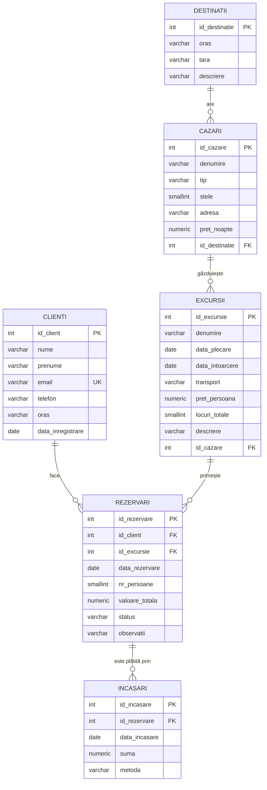

# Hoinar: baza de date pentru o firmă de turism

**Proiect Sincretic II A: Utilizarea și proiectarea bazelor de date (BD + PBD)**
Universitatea Politehnica Timișoara · Informatică (ID), anul III · **Tema 10**
Autor: Marco Vinter

**Aplicația online:** https://vintermarco.github.io/firma-turism/

Aplicația gestionează activitatea unei agenții de turism: **excursii, locuri de cazare, clienți, rezervări și încasări**.
Baza de date este **PostgreSQL** și rulează direct în browser (prin [PGlite](https://pglite.dev), PostgreSQL compilat în WebAssembly), deci aplicația nu are nevoie de server și nici de instalare.

> La prima deschidere baza de date se creează în browser din scripturile din folderul `sql/` (durează câteva secunde).
> Modificările se păstrează în browserul fiecărui utilizator. Butonul **„Resetează datele”** readuce baza la datele de test inițiale.

## Ce conține baza de date

| Tabel | Înregistrări | Descriere |
|---|---:|---|
| `destinatii` | 25 | orașele / zonele (România și străinătate) |
| `cazari` | 40 | hoteluri, pensiuni, vile, apartamente, resorturi |
| `excursii` | 70 | pachete între noiembrie 2025 și martie 2027 |
| `clienti` | 300 | clienți cu date de contact |
| `rezervari` | 1.500 | rezervări active și anulate |
| `incasari` | 2.550 | plăți (avans, rate, integral) |

Plus: **3 view-uri**, **4 funcții** (+3 funcții de trigger), **1 procedură stocată**, **3 triggere**, **8 indecși**, **3 roluri** cu drepturi diferite.

## Diagrama entitate-relație



## Regulile verificate de baza de date

1. **Fără overbooking:** o rezervare nu poate cere mai multe locuri decât sunt libere (trigger `trg_verifica_rezervare`).
2. **Valoarea se calculează automat:** `nr_persoane × pret_persoana` (același trigger).
3. **Nu se încasează mai mult decât restul de plată** și nici pentru o rezervare anulată (trigger `trg_verifica_incasare`).
4. **O rezervare cu plăți nu poate fi anulată**, iar o rezervare anulată eliberează locurile.
5. **Locurile unei excursii nu pot scădea sub cele deja rezervate** (trigger `trg_verifica_locuri_excursie`).
6. Constrângeri `CHECK`, `UNIQUE`, `NOT NULL` și chei străine `ON DELETE RESTRICT` pe toate tabelele.

## Structura proiectului

```
firma-turism/
├── index.html              aplicația (o singură pagină)
├── css/style.css           aspectul
├── js/
│   ├── app.js              paginile și operațiile
│   ├── db.js               conexiunea la PostgreSQL (PGlite)
│   └── ui.js               tabel, formulare, ferestre, grafice
├── sql/
│   ├── 01_schema.sql       tabele, chei, constrângeri, indecși
│   ├── 02_logica.sql       funcții, triggere, procedură, view-uri
│   ├── 03_date_test.sql    datele de test (generate)
│   ├── 04_interogari.sql   20 de interogări (Q01–Q20)
│   └── 05_roluri.sql       utilizatori și drepturi (doar pe server)
└── tools/genereaza_date.py generatorul datelor de test
```

## Rulare locală (Mac)

Aplicația are nevoie de un server web (nu merge cu dublu-click pe `index.html`). În Terminal, în folderul proiectului:

```bash
python3 -m http.server 8000
```

apoi deschide http://localhost:8000.

## Rulare pe un server PostgreSQL (opțional)

Cu [Postgres.app](https://postgresapp.com) sau `brew install postgresql@16`:

```bash
createdb turism
psql -d turism -f sql/01_schema.sql
psql -d turism -f sql/02_logica.sql
psql -d turism -f sql/03_date_test.sql
psql -d turism -f sql/05_roluri.sql
psql -d turism -f sql/04_interogari.sql   # Q19 și Q20 trebuie să dea eroare (testează triggerele)
```

Datele de test se pot regenera cu `python3 tools/genereaza_date.py`.
